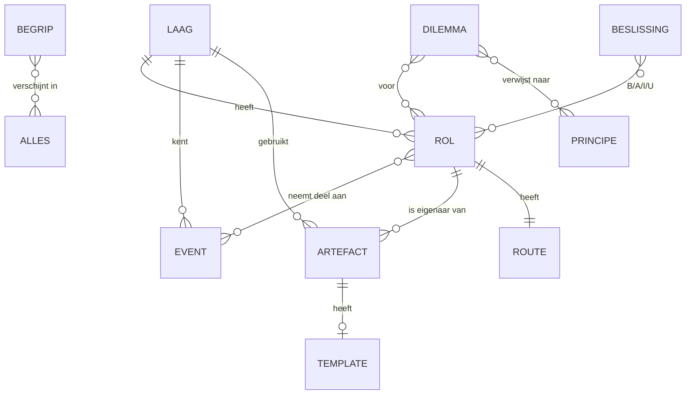

# Contentmodel — Playbook Digitaal Operating Model

> Status: concept v0.1
> Doel: inhoud en code scheiden, zodat inhoud geschreven en beheerd kan worden zonder de code aan te raken.

## Uitgangspunten

- **Eén bestand per item**: Markdown met YAML-frontmatter in `content/<type>/<id>.md`.
  Lijstachtige data (beslismatrix, verschuivingen, routes) staat in `content/data/*.yaml`.
- **Bij de build** worden alle items gevalideerd (verplichte velden, kapotte verwijzingen) en in het ene HTML-bestand gebundeld.
- **Verwijzen gaat via `id`**, nooit via titel. Een titel mag dus veranderen zonder dat links breken.
- **Begrippen worden automatisch herkend**: elk woord dat in de woordenlijst staat, krijgt in lopende tekst een hover-uitleg.
- **Taal**: alleen Nederlands. Aanspreekvorm *je/jij*, conform Facilicom.

---

## Basisvelden (gelden voor elk contenttype)

| Veld | Type | Verplicht | Toelichting |
|---|---|---|---|
| `id` | slug | ✔ | Uniek, wordt ook de URL (`product-owner`) |
| `type` | enum | ✔ | Zie contenttypen hieronder |
| `titel` | tekst | ✔ | Max. ~60 tekens |
| `kern` | tekst | ✔ | **Eén zin**, max. 140 tekens. De "30-seconden-laag" |
| `samenvatting` | markdown | ✔ | 2 tot 4 zinnen |
| `body` | markdown | – | De verdieping. Staat onder de frontmatter |
| `visual` | component-ref | – | Bijv. `modelkaart`, `ritme-wiel`, `illustratie:teamanatomie` |
| `rollen` | id[] | – | Voor wie is dit relevant (stuurt filters en routes) |
| `thema` | enum[] | – | `sturing`, `planning`, `samenwerking`, `kwaliteit`, `financiering`, `cultuur`, `techniek` |
| `gerelateerd` | id[] | – | Handmatige "zie ook"-links |
| `safe` | object | – | `{ term: "Agile Release Train", afwijking: "…" }` |
| `status` | enum | ✔ | `concept` · `review` · `vastgesteld` |
| `eigenaar` | tekst | ✔ | Wie is inhoudelijk verantwoordelijk |
| `bijgewerkt` | datum | ✔ | Wordt getoond en voedt "Wat is nieuw" |

> **Het `safe`-veld** houdt het "SAFe als uitgangspunt, maar niet precies"-principe beheersbaar.
> In de UI wordt het een klein label: *SAFe: Agile Release Train*, plus een uitklapper *"Hoe wij het doen"*.

---

## Contenttypen

### 1. `pagina`: vrije pagina
Voor verhalende pagina's (Het verhaal, Over dit playbook).

| Veld | Type | Toelichting |
|---|---|---|
| `secties` | object[] | `{ titel, body, visual? }`: voor scrollverhalen |
| `sectie` | enum | Plaats in de navigatie: `waarom`, `model`, … |
| `volgorde` | getal | Volgorde binnen de sectie |

### 2. `laag`: niveau van het operating model
Portfolio, waardestroom, productgroep, productteam. Voedt de **modelkaart**.

| Veld | Type | Toelichting |
|---|---|---|
| `niveau` | 1–4 | 1 = portfolio … 4 = team |
| `doel` | tekst | Waarom bestaat deze laag |
| `rollen` | id[] | Rollen die op deze laag werken |
| `events` | id[] | Events op deze laag |
| `artefacten` | id[] | Artefacten op deze laag |
| `beslist_over` | tekst[] | Wat wordt op deze laag besloten |
| `kaart` | object | `{ positie, kleur, icoon }`: plek op de modelkaart |

### 3. `rol`
| Veld | Type | Toelichting |
|---|---|---|
| `laag` | id | Op welk niveau |
| `in_een_zin` | tekst | "Jij zorgt dat…" |
| `verantwoordelijkheden` | tekst[] | 5 tot 8 bullets |
| `niet_meer` | tekst[] | **Wat je níet (meer) doet**: cruciaal in een kanteling |
| `werkt_samen_met` | `{ rol, waarover }[]` | Voedt het interactiediagram |
| `events` | `{ event, rol_in_event }[]` | Bijv. `{ event: pi-planning, rol_in_event: "presenteert de visie" }` |
| `tijdsbesteding` | `{ activiteit, procent }[]` | Visual: "een week van een PO" |
| `competenties` | tekst[] | |
| `van_naar` | `{ van, naar }[]` | Bijv. *projectleider → product owner* |
| `illustratie` | ref | Rolportret |

### 4. `event`: overleg of ceremonie
| Veld | Type | Toelichting |
|---|---|---|
| `cadans` | enum | `dagelijks`, `iteratie`, `kwartaal`, `portfolio`, `ad-hoc` |
| `wanneer` | tekst | "Dag 1 van de iteratie" |
| `duur` | tekst | "Max. 4 uur per 2 weken" |
| `doel` | tekst | |
| `deelnemers` | `{ rol, verplicht: bool }[]` | |
| `input` | id[] / tekst[] | Artefacten of informatie die je meeneemt |
| `output` | id[] / tekst[] | Wat het oplevert |
| `agenda` | `{ tijd, onderdeel }[]` | Voor de tijdlijnvisual (vooral PI-planning) |
| `goed_als` | tekst[] | Kenmerken van een goed event |
| `valkuilen` | tekst[] | Anti-patronen |
| `facilitatietips` | tekst[] | Voor de team coach |
| `wiel` | object | `{ ring, positie }`: plek op het ritme-wiel |

### 5. `artefact`
Backlog, user story, DoD, roadmap, PI-doelen, …

| Veld | Type | Toelichting |
|---|---|---|
| `eigenaar_rol` | id | Wie is eigenaar |
| `laag` | id | |
| `wat_staat_erin` | tekst[] | |
| `voorbeeld` | markdown | Concreet voorbeeld (later uit de eigen organisatie) |
| `checklist` | tekst[] | "Is mijn … goed?" |
| `template` | id | Link naar een invulbaar template |

### 6. `template`: invulbaar canvas
| Veld | Type | Toelichting |
|---|---|---|
| `layout` | enum | `canvas-grid`, `formulier`, `tabel`, `checklist` |
| `velden` | `{ id, label, hulptekst, type, vak? }[]` | `vak` = positie in het canvas |
| `export` | enum[] | `print`, `markdown`, `kopieer` |

Ingevulde templates worden lokaal (`localStorage`) bewaard, per template.

### 7. `begrip`: woordenlijst
| Veld | Type | Toelichting |
|---|---|---|
| `term` | tekst | De term zoals wij hem gebruiken |
| `synoniemen` | tekst[] | Varianten die ook herkend worden in tekst |
| `safe_term` | tekst | Originele SAFe-term |
| `uitleg_kort` | tekst | Max. 200 tekens: dit verschijnt in de hover |
| `afkorting` | tekst | PI, WSJF, ART, … |

### 8. `principe`
| Veld | Type | Toelichting |
|---|---|---|
| `nummer` | getal | |
| `in_onze_woorden` | tekst | |
| `safe_principe` | tekst | Origineel |
| `in_de_praktijk` | tekst | Herkenbaar voorbeeld |
| `wat_je_ziet` / `wat_je_niet_ziet` | tekst[] | Gedrag |

### 9. `verschuiving`: van → naar *(data: `verschuivingen.yaml`)*
Voedt de **Van→Naar-slider**.

| Veld | Type | Toelichting |
|---|---|---|
| `dimensie` | tekst | Financiering, sturing, team, planning, succes, eigenaarschap |
| `van` | tekst | Projectgericht |
| `naar` | tekst | Productgericht |
| `waarom` | tekst | |
| `icoon` | ref | |

### 10. `beslissing`: beslismatrix *(data: `beslismatrix.yaml`)*
| Veld | Type | Toelichting |
|---|---|---|
| `besluit` | tekst | "Wat komt er in de volgende iteratie?" |
| `thema` | enum | |
| `laag` | id | |
| `rollen` | `{ rol: code }` | Code: **B**eslist · **A**dviseert · **I**nformeren · **U**itvoert |
| `toelichting` | tekst | |

### 11. `dilemma`
| Veld | Type | Toelichting |
|---|---|---|
| `situatie` | markdown | Herkenbaar scenario, 3 tot 5 zinnen |
| `vraag` | tekst | "Wat doe jij?" |
| `opties` | `{ tekst, feedback, kwaliteit: beste\|kan\|valkuil }[]` | 3 of 4 opties |
| `leerpunt` | tekst | De kernles |
| `verwijst_naar` | id[] | Naar rol, event of principe |
| `rollen`, `thema` | | Filters |

### 12. `scan`: teamscan
| Veld | Type | Toelichting |
|---|---|---|
| `dimensies` | `{ id, naam, vragen: { id, tekst, schaal: 1-5, ankers }[] }[]` | Bijv. teamwerk, productdenken, flow, kwaliteit, klantwaarde |
| `duiding` | `{ dimensie, laag, hoog, tip }[]` | Feedback per score |
| `export` | enum[] | `print`, `markdown`, `png-radar` |

### 13. `mythe` / `faq`
| Veld | Type | Toelichting |
|---|---|---|
| `vraag` of `mythe` | tekst | |
| `antwoord` of `feit` | markdown | |
| `rollen`, `thema` | | Filters |

### 14. `route`: persoonlijk leerpad *(data: `routes.yaml`)*
| Veld | Type | Toelichting |
|---|---|---|
| `rol` | id | |
| `stappen` | `{ item: id, waarom: tekst }[]` | De eerste 5 vormen "jouw top 5" |
| `eerste_30_dagen` | `{ week, actie }[]` | |

### 15. `mijlpaal`: transitie-roadmap *(data: `transitie.yaml`)*
| Veld | Type | Toelichting |
|---|---|---|
| `golf` | tekst | |
| `periode` | tekst | "Q1 2027" |
| `wat` | tekst | |
| `voor_wie` | id[] | Rollen of divisies |
| `status` | enum | `gepland`, `bezig`, `afgerond` |

### 16. `release`: wat is nieuw *(data: `changelog.yaml`)*
`{ versie, datum, wijzigingen: { item: id, wat }[] }`

---

## Relaties in één beeld



De relaties worden **één keer vastgelegd en dan in beide richtingen getoond**. Een rolpagina toont automatisch "jouw events" en een eventpagina "wie is erbij", zonder dubbel onderhoud.

---

## Voorbeeld: `content/rollen/product-owner.md`

```markdown
---
id: product-owner
type: rol
titel: Product Owner
kern: Jij maximaliseert de waarde die jouw team levert, iteratie na iteratie.
samenvatting: >
  Als Product Owner ben je de stem van de gebruiker in het team. Je beheert de teambacklog,
  maakt keuzes in wat eerst komt en accepteert het werk van het team.
laag: productteam
safe:
  term: Product Owner
  afwijking: Bij ons is de PO ook aanspreekpunt voor de operatie van de divisie.
in_een_zin: Jij zorgt dat het team altijd werkt aan het meest waardevolle.
verantwoordelijkheden:
  - Beheert en ordent de teambacklog
  - Schrijft en verfijnt stories samen met het team
  - Accepteert opgeleverd werk
niet_meer:
  - Je stuurt niet op uren of taken van teamleden
  - Je schrijft geen volledig functioneel ontwerp vooraf
werkt_samen_met:
  - { rol: product-manager, waarover: "features en prioriteiten in de productgroep" }
  - { rol: team-coach, waarover: "ritme en verbetering van het team" }
events:
  - { event: iteratieplanning, rol_in_event: "brengt de prioriteiten in" }
  - { event: pi-planning, rol_in_event: "vertaalt features naar teamdoelen" }
tijdsbesteding:
  - { activiteit: Backlog & refinement, procent: 35 }
  - { activiteit: Stakeholders & gebruikers, procent: 30 }
  - { activiteit: Met het team, procent: 25 }
  - { activiteit: Overig, procent: 10 }
rollen: [product-owner, product-manager, teamlid]
thema: [planning, samenwerking]
status: concept
eigenaar: Agile CoE
bijgewerkt: 2026-10-24
---

## Een week als Product Owner
…
```

## Voorbeeld: dilemma

```yaml
id: dilemma-spoedverzoek
type: dilemma
titel: Het spoedverzoek van de directeur
situatie: >
  Halverwege de iteratie belt de operationeel directeur van je divisie. Een grote klant wil
  volgende week een nieuwe rapportage in de klantportal. "Kan het team dit er even bij doen?"
vraag: Wat doe jij als Product Owner?
opties:
  - tekst: Je zegt ja en vraagt het team het tussendoor op te pakken.
    kwaliteit: valkuil
    feedback: De iteratie raakt verstoord en het team verliest focus en voorspelbaarheid.
  - tekst: Je bespreekt de waarde en zet het bovenaan de backlog voor de volgende iteratie.
    kwaliteit: beste
    feedback: Je maakt de afweging transparant en beschermt het ritme.
  - tekst: Je verwijst door naar de Product Manager.
    kwaliteit: kan
    feedback: Soms nodig als het de productgroep raakt, maar het blijft wel jouw backlog.
leerpunt: Prioriteren is jouw rol. Ook "ja, en dan…" is een keuze.
verwijst_naar: [product-owner, iteratieplanning, principe-flow]
rollen: [product-owner, business-stakeholder]
thema: [planning]
status: concept
```

---

## Mappenstructuur (voor de build)

```
content/
├── paginas/          waarom, verhaal, over
├── lagen/            portfolio, waardestroom, productgroep, productteam
├── rollen/
├── events/
├── artefacten/
├── templates/
├── principes/
├── begrippen/
├── dilemmas/
├── faq/
├── scan/teamscan.yaml
└── data/
    ├── verschuivingen.yaml
    ├── beslismatrix.yaml
    ├── routes.yaml
    ├── transitie.yaml
    └── changelog.yaml
```

## Omvang eerste versie (inschatting)

| Type | Aantal |
|---|---|
| Lagen | 4 |
| Rollen | 8 |
| Events | 9 |
| Artefacten | 8 |
| Templates | 5 |
| Principes | 10 |
| Begrippen | ~50 |
| Dilemma's | 10 tot 15 |
| FAQ / mythes | ~20 |
| Verschuivingen | 6 tot 8 |
| Beslissingen | ~25 |

Dat zijn ongeveer **150 contentitems**. Dat is de echte inspanning; de techniek is daar een fractie van.
